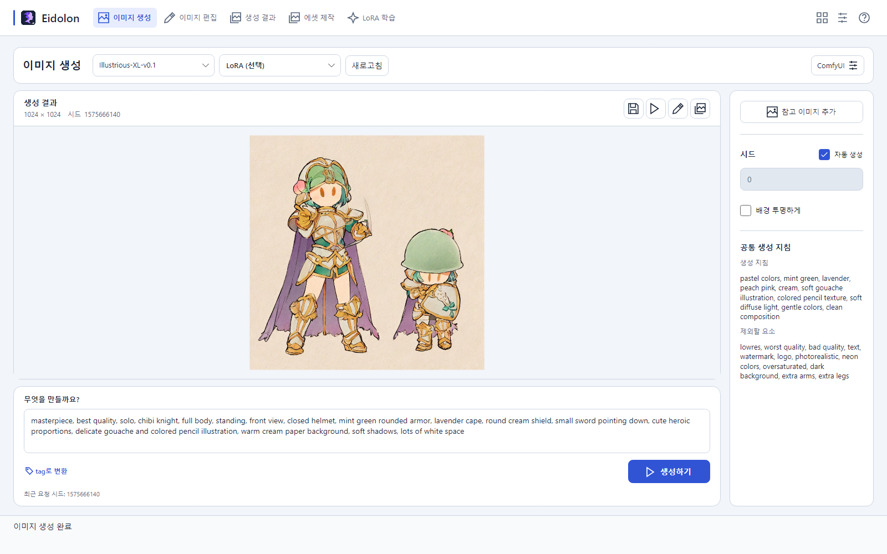
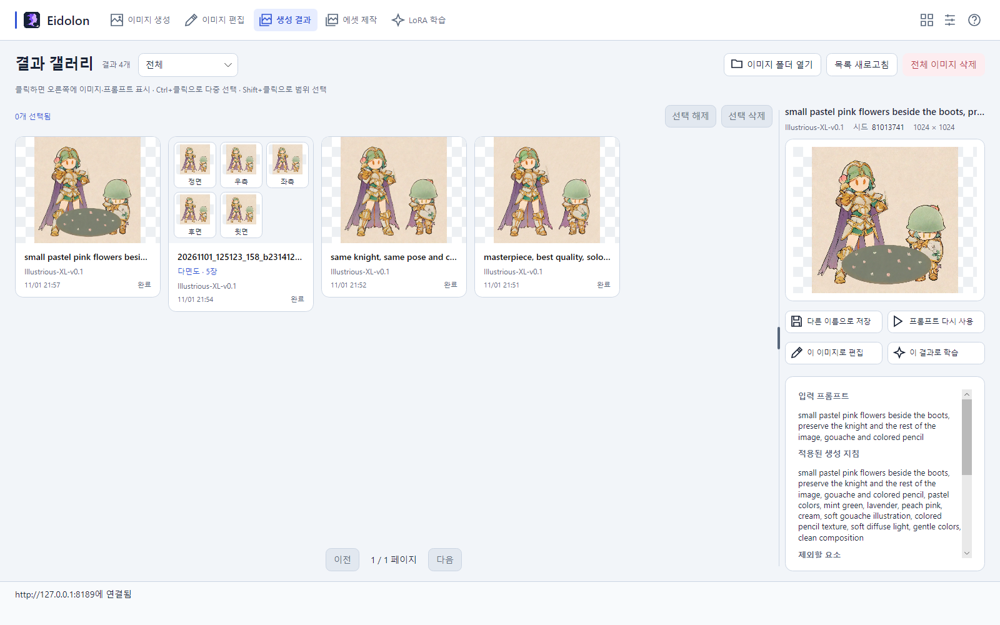
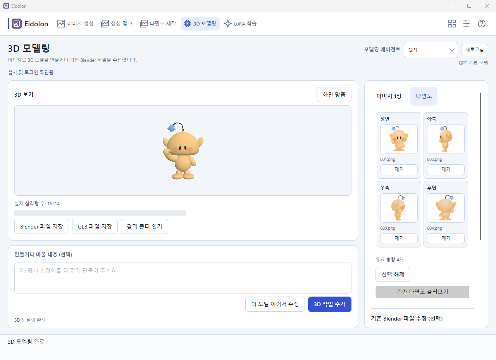
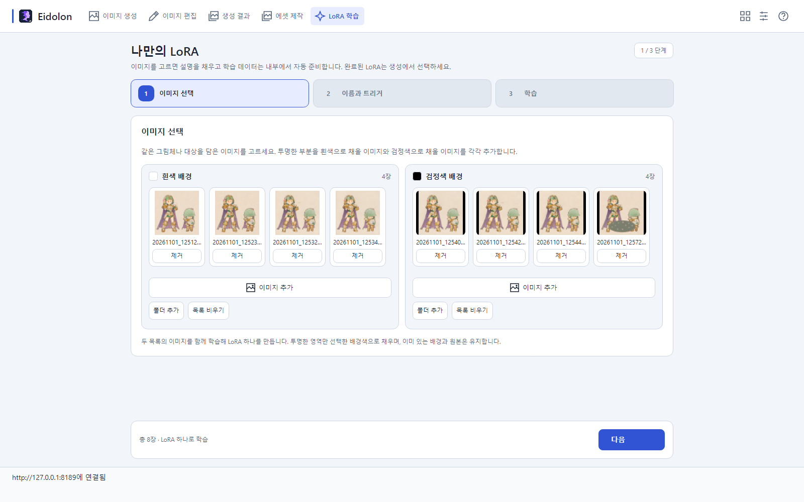

# Eidolon

[한국어](README.md) | **English**

**Eidolon is a desktop app for generating and editing images, creating game assets, and training LoRAs from prompts and reference images.**

Choose ComfyUI or your installed Codex, then work with shared generation guidelines, saved results and multi-view sheets in one app.

## Download

| Platform | Download |
|---|---|
| Windows x64 | [Eidolon-v1.0.6-win-x64.exe](https://github.com/EomTaeWook/Eidolon/releases/download/v1.0.6/Eidolon-v1.0.6-win-x64.exe) |
| macOS 14+ · Apple Silicon | [Eidolon-v1.0.6-osx-arm64.app.zip](https://github.com/EomTaeWook/Eidolon/releases/download/v1.0.6/Eidolon-v1.0.6-osx-arm64.app.zip) |
| macOS 14+ · Intel | [Eidolon-v1.0.6-osx-x64.app.zip](https://github.com/EomTaeWook/Eidolon/releases/download/v1.0.6/Eidolon-v1.0.6-osx-x64.app.zip) |

[Release notes](https://github.com/EomTaeWook/Eidolon/releases/tag/v1.0.6)

On Windows, run the single `.exe`. On Mac, extract the ZIP, move `Eidolon.app` to a writable Applications folder, and open it in Finder. No separate .NET installation is required. The Mac apps are ad-hoc signed without Apple notarization; the first launch may require approval under Privacy & Security in System Settings.

On Mac, use your installed, signed-in Codex or an external ComfyUI server. Local ComfyUI, training and prompt-converter installation remain Windows x64 only. Both platforms check for updates once at startup. **Update and restart** inside the app performs download, verification, normal shutdown, replacement and restart.

## Actual app screens

Eidolon 1.0.0 in Korean with the light theme. Pastel images were generated through the app using ComfyUI and Illustrious-XL-v0.1, then used for editing and asset creation.

### Image generation



Describe the image and choose a reference and background options. Review the generated result above while preparing the next request in the input below.

### Results



Select an image in the gallery to read its prompt and generation settings. Save the result, reuse its prompt, edit it, or use it for training.

### 3D modeling



The app shows a telescope generated from a reference image in the 3D preview. You can save the result as a Blender or GLB file or continue editing it.

### LoRA training



Add training images to the white or black background lists. Review the images, name and trigger, then configure training. The app prepares the dataset automatically.

The training screenshot shows image selection; training was not started. See the [user guide](Docs/Usage.md) in Korean for more captures and instructions covering conversion, training steps, generation settings, app settings, and MCP.

## Core experience

- **Prompt-based generation**: Describe your subject and optionally add a reference image.
- **Shared style guidelines**: Save guidelines, exclusions, and presets for both generation and editing.
- **Continue from a result**: Inspect generation settings, reuse a prompt, edit an image, or use it for training or asset creation.
- **Game assets**: Create front, right, left, and back views from a reference, then compare and export them.
- **Train with your images**: Let the app prepare a dataset and use the completed LoRA when generating.

## Features

- **Local English-tag conversion**: After installing the model, use the small button below the input to convert Korean/English text, then review and edit it in the same field
- **Generation and editing**: ComfyUI or Codex, reference images, source-image editing, and transparent backgrounds
- **Results**: Image and multi-view filters, grouped views with per-direction preview, saved prompts and settings, reuse, export, and selected-image deletion
- **Multiple views**: Four directions, per-item regeneration and replacement, resume, and PNG, sheet, and coordinate JSON export
- **3D modeling**: Create from one image or multiple views, edit Blender scenes, preview in 3D, set a triangle limit, and save Blender or GLB files
- **Models and LoRAs**: safetensors folder scanning, SD 1.5 and SDXL families, compatible LoRA selection, and automatic trigger words
- **LoRA training**: Automatic dataset preparation, new or continued training, quick settings, cancellation, and estimated time remaining
- **Jobs**: A shared queue, additional requests while running, cancellation, pending-request cleanup, and preserved originals and logs
- **Settings and connections**: Korean and English, light and black themes, output folder, external ComfyUI servers, and MCP

Multiple views are reference-based drafts. Review generated appearance and viewpoints for your use case. Packages are available for Windows x64 and macOS (Apple Silicon and Intel).

## Run

### Run the release

1. On Windows, run the release EXE. On macOS, extract the ZIP and open Eidolon.app.
2. Open **Generation environment > Generation methods**, then choose ComfyUI or Codex.
3. For Codex, sign in to your installed Codex. Choose an execution model from the retrieved list; Default model uses the CLI default. Select `codex.exe` if the app cannot locate it.
4. For ComfyUI, prepare the engine in **Settings > Engine setup and connection**. Install a model in **Generation environment > Models and LoRAs**, or put `.safetensors` files in Model folder or LoRA folder and refresh.
5. Open **Generation environment > Shared generation instructions**, set guidelines, exclusions and presets, save the generation environment, and submit a description in **Generate**.

Settings and job data are stored under `%LOCALAPPDATA%\Eidolon`. Replacing the executable for an update preserves this data.

### Images and assets

**Edit** takes a source image and edit instructions, then saves a new image. **Results** lets you reuse a prompt, edit, or train from an image. Right-click the large result image to send it to asset creation.

**Asset creation** makes four views covering front, right, left, and back. Preview shows the generated originals, while export fits them to a shared output size. Deleting a collection removes its record and internal working files while preserving generated PNGs, prompt JSON, and exported files.

**LoRA training** guides you through image selection, name and trigger review, and training settings. It requires a local ComfyUI runtime, a base model, and an NVIDIA GPU. A saved LoRA trigger is applied automatically when generating. Local checkpoints, LoRAs, seeds, and change strength do not apply to Codex generation.

The app's **Help** screen provides instructions in both languages. See the [user guide](Docs/Usage.md) in Korean and the [asset creation guide](Docs/AssetCreation.md) for detailed workflows and export contracts.

### 3D modeling

1. Set up Blender under **Settings > Engine setup and connection > Blender** and sign in to the installed Codex CLI. Modeling uses the GPT agent model saved in the generation settings.
2. Open **3D Modeling** and select one reference image or multiple views. To change an existing model, open a .blend file and describe the edit, or choose **Continue editing this model** on a result.
3. Add the job, inspect the 3D preview and actual triangle count, then save a Blender or GLB file. Edits preserve the original file.

See the [3D modeling guide](Docs/Modeling.md) for view directions, triangle limits, and output locations.

### Run from source

Development requires the .NET 10 SDK. From the repository root:

```powershell
dotnet run --project Eidolon.App/Eidolon.App.csproj
```

## MCP

The MCP server starts automatically after app initialization. Register `http://127.0.0.1:8190/mcp` with your client. View the server status or manually stop and start it in **Settings > MCP connection**. Generation, editing, results, asset creation, 3D modeling, and LoRA training use the same job queue as the UI. Queue a modeling job with `eidolon_model_3d` and retrieve its result with `eidolon_get_modeling_result`. Training accepts absolute image or folder paths for white and black backgrounds directly and trains both groups into one LoRA. Per-request guidelines leave saved settings unchanged. See [MCP usage](Docs/Mcp.md) for examples and connection details.

## Technology

- **Language and runtime**: C# / .NET 10
- **Distribution**: Windows x64, macOS Apple Silicon and Intel
- **UI**: Avalonia
- **Generation**: ComfyUI or installed Codex

See [Architecture](Docs/EidolonArchitecture.md), [Docs](Docs/README.md), and [Working rules](Docs/WorkingRules.md) for implementation and development details.

## Data and publishing

The source of localized text is `Excel/String.xlsx`. ExcelToJson and JsonToCSharp generate runtime data and C# templates. Debug reads output-folder JSON first; Release uses the JSON embedded in the executable. Follow [String data generation](Docs/StringData.md).

Publish the self-contained Windows x64 executable with:

```powershell
dotnet publish Eidolon.App/Eidolon.App.csproj -p:PublishProfile=WindowsX64 -o artifacts\win-x64 -m:1 /p:UseSharedCompilation=false
```

The executable includes the runtime, UI libraries, localized resources, and notices. Generation engines and weights are installed separately in your selected directory. See [local prompt conversion](Docs/PromptConversion.md) for installation, conversion and generation checks and limitations, the earlier [multi-view validation record](Docs/AssetCreationQuality.md), and the [release notes](Docs/Releases/1.0.2.md) for this update.

## License

Eidolon is source-available software under the [Eidolon Source License 1.0](LICENSE).

The independent [MCP.Core](https://github.com/EomTaeWook/Mcp.Core) submodule is licensed separately under [MIT](Mcp.Core/LICENSE).

- Free use is permitted for personal, educational, internal business, and commercial game and asset production.
- Modification and free redistribution are permitted when license and copyright notices are preserved, material changes are identified, and recipients receive the same terms.
- Selling or charging for Eidolon, including modified, repackaged, or renamed apps based substantially on it, requires separate written permission from the copyright holder.
- The app's resale restriction does not apply to user outputs such as generated images, sprites, sheets, or trained LoRAs. Model licenses, service terms, input permissions, and third-party rights still apply.

Users are responsible for checking rights to inputs and outputs, their use, sale and distribution, and compliance with applicable laws and terms. The developer does not warrant the legality, ownership, or non-infringement of outputs and limits liability to the extent permitted by law. Liability that cannot lawfully be excluded remains unaffected. See [LICENSE](LICENSE) for the governing terms.

## Third-party components

Eidolon uses Avalonia for its UI, ComfyUI for local generation, and sd-scripts for training. Models and additional weights retain their distributors' terms. See [Third-party notices](Docs/ThirdPartyNotices.md) for licenses, versions, and notices delivered during installation.
